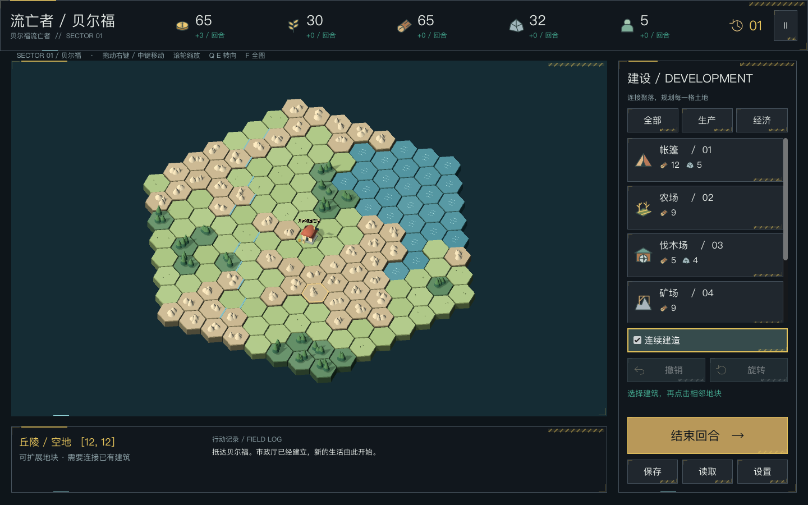

# 流亡者：贝尔福 · Godot 2.5D

一款以流亡者在法国贝尔福地区建立家园为背景的单机回合制聚落建设游戏。你需要在六边形地图上连接建筑、平衡金币、粮食、木材与石材，并维持人口增长。场景采用正交斜俯视的低多边形三维模型，形成 2.5D 观感。

本仓库仅维护 **Godot 版本**，当前是可运行的建设玩法原型；尚未提供正式发行包或确认的发行版本号。已在本机 Godot **4.7.2**、macOS / Apple Silicon、Compatibility 渲染器下验证；其他平台和导出流程尚未验证。



[文档索引](docs/README.md) · [贡献说明](CONTRIBUTING.md) · [Agent 约定](AGENTS.md) · [更新记录](CHANGELOG.md)

## 打开与运行

1. 安装 Godot 4.7 系列；当前本机使用 4.7.2。无需 C# / .NET 版本。
2. 下载或克隆本仓库，在 Godot 项目管理器选择「导入」，打开根目录的 `project.godot`。
3. 等待首次资源导入完成，按 **F5** 运行主场景。

也可在**仓库根目录**通过终端启动，`godot` 需指向实际可执行文件：

```bash
godot --headless --path . --editor --import --quit
godot --path .
```

macOS 可将 `godot` 替换为 `/Applications/Godot.app/Contents/MacOS/Godot`。游戏运行不依赖 Python、外部素材服务或网络。`tools/` 中的 Python 工具仅用于开发时重新生成部分图标、音效和初版注释；运行游戏不用它们。

## 已实现的游戏内容

新聚落以市政厅为中心，显示**半径 7 圈的六边形地图，共 169 格**，初始资源为金币 65、粮食 30、木材 65、石材 32，人口 5，回合 1。内部地形数据仍使用 23×17 格，以兼容旧存档；旧存档继续显示原有完整矩形地图。地形从仓库内的固定数据 `data/original_map.json` 加载。

| 建筑 | 费用 | 每回合产出 | 地形与占地 |
|---|---|---|---|
| 市政厅 | 初始自带 | 金币 +3、粮食 +2 | 聚落中心 |
| 帐篷 | 木材 12、石材 5 | 金币 +2、人口 +1 | 相邻三格；草原 / 森林 |
| 农场 | 木材 9 | 粮食 +5 | 草原 / 森林 |
| 伐木场 | 木材 5、石材 4 | 木材 +5 | 森林 |
| 矿场 | 木材 9 | 石材 +4 | 丘陵 |
| 市场 | 木材 16、石材 12 | 金币 +7 | 草原 / 森林 |
| 工坊 | 木材 20、石材 16、金币 15 | 木材 +2、石材 +2 | 草原 / 森林 |

所有新建筑都必须连接已有聚落。人口每回合消耗 `ceil(人口 / 4)` 粮食；粮食不足时归零，并停止本回合的人口增长。农场可以建在草原或森林。

新增四个原创势力，均可编辑名称与背景，区别为旗帜、徽记和配色，不附带隐藏经济加成。UI 参考明日方舟式战术终端的深色面板、黄色斜纹、角标、扫描条与错时入场；资源栏、地块信息与回合按钮参考六边形策略游戏的交互习惯。所有图标、旗帜、模型与合成音效均为本项目生成。

## 操作

| 输入 | 操作 |
|---|---|
| 左键地块 | 选择 / 建造；地块短暂下压并回弹 |
| `1`–`6` | 选择对应建筑；再次选择取消 |
| `R` | 旋转建筑，每次 60°，帐篷可使用全部六种占地方向 |
| 右键轻点 / `Esc` | 优先取消建造；未建造时 Esc 打开暂停 |
| 右键 / 中键拖动 | 移动镜头，不会同时取消建造 |
| 滚轮 / 触控板捏合 | 以指针位置为中心缩放 |
| 触控板双指移动 / `WASD` | 平移镜头 |
| `Q` / `E` | 水平转动镜头 |
| `F` | 镜头归位到市政厅，显示完整六边形地图 |
| `Enter` | 结束回合并自动保存；按键重复和连击受到保护 |
| `⌘S` / `Ctrl+S` | 快速保存 |
| `⌘O` / `Ctrl+O` | 读取或导入 JSON |
| `⌘Z` / `Ctrl+Z` | 撤销本回合最近一次建造并退还全部材料 |
| `F11` | 全屏 / 窗口 |

建造卡片可滚动，悬停显示费用、地形和收益。连续建造默认开启；有效地块显示绿色幽灵，非法位置显示红色并说明原因。顶栏的资源均为图标加数值，下面一行是下回合净变化。结束回合后撤销栈清空。

## 视觉与声音

- 正交斜俯视镜头与真实三维地形，单格半径为 1.25。默认显示完整七圈地图，可滚轮拉近查看建筑。
- 每格为独立 `StaticBody3D`，具备独立凸碰撞体；点击下压 0.16 世界单位并回弹。连续点击不会累计下沉。
- 独立六边形地块厚 0.8 世界单位，采用平面法线、硬边倒角和较暗侧面，不使用长方形底板。
- 日光与环境光强度经过降低，采用 Linear 色调映射和较浅阴影，避免 Filmic 映射下的泛白。
- 木梁、石块、屋顶等网格从空中错时落下组成建筑；工坊改为在离地 3.8 单位的空中组装，悬停后整栋加速下砸，再轻微回弹。工坊触地时，地块、其上的建筑与资源同步形成向外扩散并衰减的单圈波纹，波前附带青色轮廓。最终传播速度为 24 世界单位/秒，最大抬升高度为 0.68，均为初版的两倍。每格只抬升并平滑归位一次，没有反向波谷或弹性余波。
- 市政厅旗帜、帐篷布、农场麦穗、伐木场锯片、矿场吊臂与石料、市场棚布、工坊齿轮分别有完工后的持续动画。
- 四种资源分别有可复用的三维场景：金币堆、麦穗粮袋、木料堆、石块堆；摆放在对应建筑周围。
- 点击、非法操作、材料落地、完工、回合、保存、撤销共七种原创 WAV 音效。声音采用通道复用，避免密集落地声叠加过响。
- 主菜单、势力、暂停、设置、资源栏、建筑卡片、提示和存档窗口统一使用斜纹与角标。面板错时入场，按钮有悬停扫光和点击亮闪，资源与回合数变化时短暂高亮。
- 设置支持音量、静音、动态效果和全屏；关闭动态效果会立即停止拼装、地块波纹与 UI 动画，恢复静态完整建筑和地块高度。

## 存档

使用 JSON，可从「读取」导入已有存档，包括 `tent_part` 多格帐篷和旧矩形地图。导入按实际字段校验，不保证所有历史文件均兼容。

手动存档与自动存档分别保存，主菜单「继续存档」选择修改时间较新的文件。结束回合、返回主菜单、关闭游戏窗口都会保存自动存档。暂停菜单可另存为指定路径。

macOS 用户数据目录通常为：

```text
~/Library/Application Support/Godot/app_userdata/流亡者：贝尔福 · 2.5D/
```

其中 `belfort_save.json` 为手动存档，`belfort_autosave.json` 为自动存档，`settings.cfg` 为偏好。读档采用临时状态整体校验，坏文件不会部分覆盖当前游戏。写入采用临时文件加原子重命名。

## 学习源码

先读 [技术栈](docs/technical-stack.md) 与 [架构与源码阅读](docs/architecture.md)，再按 `game_state.gd → main.gd → world_view.gd → hud.gd` 的顺序阅读。核心 `.gd` 文件使用中文 XML 风格文档；新增或修改代码的注释要求见 [Agent 约定](AGENTS.md)。

```gdscript
## <summary>判断地块坐标是否处于地图边界内。</summary>
## <param name="cell">从 0 开始的列、行坐标。</param>
## <returns>布尔值；true 为地图内。</returns>
static func in_bounds(cell: Vector2i) -> bool:
	return cell.x >= 0 and cell.x < WIDTH and cell.y >= 0 and cell.y < HEIGHT
```

这些是源码中的 XML 格式注释；Godot 的文档系统不会像 C# 一样自动生成标准 XML 文档。模型使用程序化基础网格，修改 `model_factory.gd` 即可调整外形；各 `.tscn` 为可复用组件入口，`kind` 可在检查器选择。运行时生成的节点可在 Godot 的「远程」场景树中查看。

## 检查

在工程目录执行（命令中的 Godot 路径按本机安装位置调整）：

```bash
/Applications/Godot.app/Contents/MacOS/Godot --headless --path . --editor --import --quit
/Applications/Godot.app/Contents/MacOS/Godot --headless --path . --script res://tests/test_model.gd
/Applications/Godot.app/Contents/MacOS/Godot --headless --path . --script res://tests/test_scene.gd
```

规则测试覆盖资源、地形限制、占地、旋转、连接、饥荒、撤销和新旧存档。集成测试实际实例化主场景，覆盖势力、碰撞拾取、顶面法线、独立地块下压、资源模型、七类建筑动画、动态关闭、工坊触地信号、波纹延迟传播和高度复位、UI 装饰和音效资源。

实际渲染截图可用 `--script res://tests/capture_visuals.gd` 重新导出到 `artifacts/hex7-ui/`。

## 当前范围

当前实现了聚落建设、资源与人口结算、势力外观、存档、建造撤销和表现动画。尚无军队、战斗、科技树、外交、AI 对手、联网系统或明确胜利条件。资源与建筑使用原创低多边形模型；旗帜采用带图案的网格摆动，帐篷与棚布使用部件运动，不是布料物理模拟。

## 参与贡献

所有修改通过独立分支提出 **PR**，经维护者审核后进入主分支；不要直接推送 `main` 或其他默认分支。流程、验证命令和提交要求见 [CONTRIBUTING.md](CONTRIBUTING.md)，Agent 执行规则见 [AGENTS.md](AGENTS.md)。每个 PR 更新 [CHANGELOG.md](CHANGELOG.md) 的 `Unreleased`。

## 项目文档

技术栈、模块架构、设计风格和验证记录统一从 [docs/README.md](docs/README.md) 查阅。旧文档文件名保留为跳转入口，正文在 `docs/` 中维护。

## 许可

仓库当前未声明开源许可证。源码可见性不等于授予复制、分发或商用许可；如需对外发布，由维护者另行明确许可证和素材使用范围。
