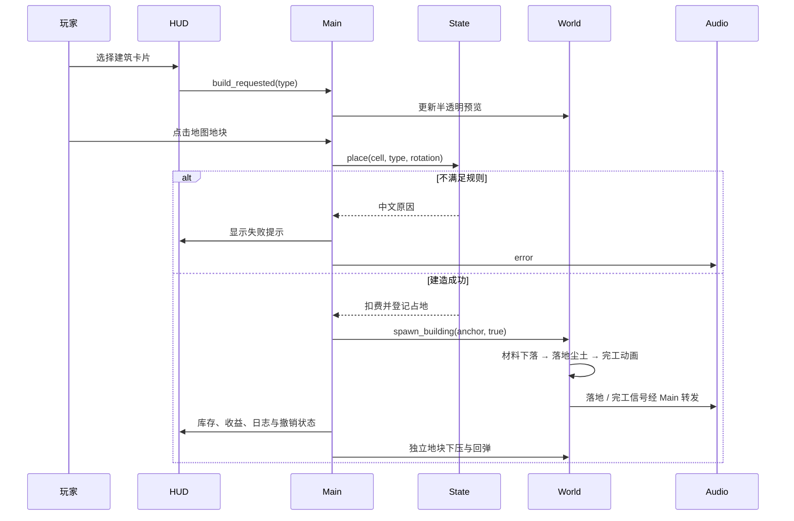

# 架构与源码阅读

本说明面向仓库内的 Godot 2.5D 工程。工程入口与依赖见 [技术栈](technical-stack.md)，协作规则见 [Agent 约定](../AGENTS.md)。

## 模块职责

| 文件 | 对象与职责 | 初学者应关注的概念 |
|---|---|---|
| `scripts/game_state.gd` | `BelfortState`，纯规则和 JSON 数据 | Dictionary、Array、Vector2i、校验与事务 |
| `scripts/front_screen.gd`、`start_menu.gd`、`faction_selection.gd` | 独立前置页面，复用 HUD 的主题、控件与档案编辑 | 场景继承、布局、草稿与信号 |
| `scripts/main.gd` | `BelfortGame`，流程与系统连接 | 场景生命周期、信号、输入与状态 |
| `scripts/world_view.gd` | `BelfortWorld`，地图、相机和拾取 | Node3D、Camera3D、碰撞、坐标转换 |
| `scripts/model_factory.gd` | `BelfortModels`，网格与材质工厂 | MeshInstance3D、基础网格、缓存 |
| `scripts/building_visual.gd` | `BelfortBuildingVisual`，拼装与完工动画 | Tween、局部变换、部件命名、信号 |
| `scripts/resource_visual.gd` | `BelfortResourceVisual`，资源模型 | 导出属性、复用组件、轻微运动 |
| `scripts/hud.gd` | `BelfortHUD`，工业 UI 与势力界面 | Control、容器、主题、图标与回调 |
| `scripts/tactical_chrome.gd` | `BelfortTacticalChrome`，全界面条纹、角标和按钮动效 | Node2D 绘制、无布局占用、统一动态开关 |
| `scripts/faction_backdrop.gd` | `BelfortFactionBackdrop`，扫描与网格 | CanvasItem 绘制、queue_redraw |
| `scripts/audio_manager.gd` | `BelfortAudio`，声音 | AudioStreamPlayer、分贝、节流 |
| `tests/test_model.gd` | 规则检查 | 无窗口测试与无副作用校验 |
| `tests/test_scene.gd` | 场景集成检查 | await、真实场景实例和动画验证 |

核心 `.gd` 方法和数据带有中文 XML 风格注释；新增方法附用途说明。`tools/document_gd.py` 保留了初版注释生成映射，新增模块的说明以源码为准。

## 启动与场景切换

`scenes/main.tscn` 保持为应用入口，`BelfortGame` 负责会话、偏好、存档和信号路由。三个独立页面为：

- `scenes/start_menu.tscn`：开始页、Logo 与继续 / 读取 / 设置入口。
- `scenes/faction_selection.tscn`：四势力选择和可编辑身份；确认之前只改草稿。
- `scenes/game.tscn`：原有游戏 HUD；控制器在首次新建或成功读档后为其挂接三维地图。

前置页面继承 `BelfortFrontScreen`，仅复用 `BelfortHUD` 的主题、装饰、反馈和设置；不创建地图、资源栏或建造栏。前置场景切换时移除并释放旧页面。开始与势力选择不调用菜单遮罩；暂停、设置和文件选择仍使用已有的遮罩或窗口。

已建立的游戏场景在返回开始页时隐藏并停用处理及子视口渲染，继续当前聚落时恢复同一个场景，避免丢失未结束回合的撤销记录。开始页成功读档也可以直接进入游戏，失败留在原页面显示原因。存档格式、规则和原子保存方法保持不变。

## 一次建造如何流动

规则立即完成，动画只是表现层。因此玩家可以在材料下落时继续选择、建造或结束回合。存档保存已经登记的完整建筑，读取时直接显示完工状态。撤销会释放建筑节点，其绑定的 Tween 随节点结束。

## 坐标与 2.5D

规则使用 `Vector2i(列, 行)`；奇数行横向偏移半格。新地图通过轴坐标距离筛选市政厅周围七圈，`contains_cell` 同时负责显示与建造边界；存档的 `map_shape` 字段区分新六边形与旧矩形。世界位置在 XZ 平面，Y 用于地形高度和建筑。六边形半径 1.25，网格顶面采用 Godot 的顺时针三角形绕序；集成测试检查顶面法线朝上，避免空洞或异常光照。

使用正交相机斜俯视真实三维模型，远处的地块不会因透视而缩小。这是本项目 2.5D 的实现方式。

每格单独创建 `StaticBody3D + CollisionShape3D + MeshInstance3D`，三维射线命中后从 metadata 取得规则坐标。动画改变物体位置，不改变规则坐标；重复点击先停止旧 Tween，再从保存的原始高度回弹。

## 三维资源组织

`models/buildings/` 有市政厅及六种可建建筑的独立 `.tscn`。`models/resources/` 有四种资源 `.tscn`。它们通过导出属性选择类型，在 `_ready` 中用工厂建立真实网格，因而无需外部 FBX、贴图或素材下载。

工厂复用同尺寸网格和同颜色材质；生成预览时使用独立透明材质，不修改共享材质。动画识别 `Flag`、`TentCloth`、`Crop`、`SawBlade`、`CraneArm`、`Awning`、`Gear` 等部件名称，修改模型时应保留这些语义入口。

## 建议阅读顺序

先阅读 `game_state.gd` 的 `placement_error → place → income → next_turn`，再看 `main.gd` 的 `_choose → _click_cell → _action`。最后进入 `world_view.gd` 和 `building_visual.gd`，观察同一份规则数据如何变成预览、材料下落、选中轮廓和声音。运行时切换 Godot 场景树到「远程」，可以逐个展开独立地块和建筑网格。

工坊的 `workshop_slam` 信号只在整栋触地时发出。`World.impact_wave` 根据地块到触点的世界距离设置延迟和衰减；所有位置 Tween 共享固定的原始高度，避免点击和重复冲击累积漂移。关闭动态效果会终止相关 Tween 并恢复高度。
